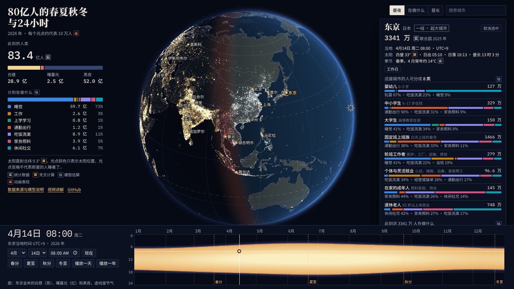

# 80亿人的春夏秋冬与24小时

一颗可以拖动的地球仪。选一个日期和时刻，看全世界 441 座城市的人此刻分成几类、各在做什么。

**在线体验：** https://wanglu2016.github.io/80yi-chunxiaqiudong/
**使用讲解视频（3分48秒）：** https://wanglu2016.github.io/80yi-chunxiaqiudong/video.html



## 怎么用

- **转动和缩放地球：** 像 Google Earth 一样，按住哪里就拖着哪里转，快速一甩会顺势转一会儿。电脑上用滚轮朝光标所在处缩放，双击放大（按住 Shift 双击缩小）；手机上单指拖动，双指捏合缩放，双击放大。地球右下角有放大、缩小和复位按钮。
- **选时间：** 底部的图横着是一年，竖着是一天，点或拖一下就能同时选定日期和时刻。也可以用下拉框，或按春分、夏至、秋分、冬至直接跳转，还能播放一天或一年。
- **看城市：** 把光标移到城市上，手机上点一下城市，就能看到这座城市的人分成哪 8 类、人数多少、此刻在做什么，以及当地时间、日出日落、季节和常年气温。点一下可以固定卡片，时间轴会换成当地时间。右上角可以搜索城市。
- **换主题：** 昼夜看太阳照到哪里，“在做什么”看每个地方的活动比例，昼长看今天白天有多长。

## 可以试试

- 夏至前后，北京时间傍晚 6 点，全世界约九成的人在白天。冬至前后，北京时间清晨不到 6 点，这个比例只有一成多。
- 工作日晚上 9 点半，比较东京和马德里有多少人还在吃饭。
- 看挪威特罗姆瑟的冬至和夏至，太阳分别整天不升和整天不落。
- 看春节的北京、斋月日落时的开罗，一天的节奏有什么不同。

## 下载

- **离线版网页（约 2 MB）：** [80yi-chunxiaqiudong-site.zip](https://github.com/wanglu2016/80yi-chunxiaqiudong/raw/main/download/80yi-chunxiaqiudong-site.zip)。解压后双击 `index.html` 即可使用，不需要联网或安装任何软件。
- **讲解视频（50 MB）：** [80yi-chunxiaqiudong-guide.mp4](https://github.com/wanglu2016/80yi-chunxiaqiudong/raw/main/video/80yi-chunxiaqiudong-guide.mp4)，也可以在[视频页](https://wanglu2016.github.io/80yi-chunxiaqiudong/video.html)点“下载视频”。
- **全部源代码：** 页面右上角绿色的 **Code → Download ZIP**。

需要较新的 Chrome、Edge、Safari 或 Firefox（支持 WebGL2）。手机也可以使用。

## 读图须知

页面把四种内容分开标注，每个数字旁都有一个小标记：

| 标记 | 含义 | 例子 |
|---|---|---|
| 实 | 统计或观测数据 | 世界人口、城市人口、年龄结构、公共假期、常年气温 |
| 算 | 天文公式算出 | 太阳直射点、日出日落、昼长 |
| 估 | 模型估算 | 白昼人口、八类人的规模、各类人此刻在做什么 |
| 画 | 动画表现 | 光点的具体位置、颜色和明暗 |

- **这不是实时数据。** 页面不收集也不显示任何真实用户的数据。
- **光点颜色是示意。** “昼夜”主题里，白天是白色；天黑后到当地 23 点是暖黄色，代表家里和街上的灯；23 点到凌晨 5 点转成白色，代表多数人已睡下、主要剩路灯；5 点以后转回暖色直到日出。这按当地钟点切换，不来自灯光观测，也不能说明某个地方的人此刻睡没睡着。
- **模型描述常态的一天。** 战争、灾害、停电等情况不在模型内，所以它对正处于危机中的城市并不准确。
- **城市用全国结构。** 年龄、就业和入学结构取所在国的数据，没有单独校正城市。
- **城市人口口径不同。** 82 座大城市用联合国 2025 年的连续建成区口径，所以雅加达有 4191 万，重庆只有 707 万，都和行政辖区人口差别很大。其余城市用 Natural Earth 汇编的都市区人口，年份不一，部分偏旧。两种数字不宜直接比较。
- **城市分线是本项目的规则。** 一线 1000 万以上，二线 300–1000 万，三线 100–300 万，四线 100 万以下，不同于中国常说的城市分线。
- **气温是常年月均值，不是当天天气。** 87 座城市附近没有合适的站点数据，卡片上会直接说明。
- 学校放假按地区近似，伊斯兰节日日期为预估，实际以当地宣布为准。
- 模型和时间利用调查的对比表，以及全部假设，在页面的“数据来源与模型说明”里。
- 作息类型、地区假设和说明文字由 AI（Claude）整理编写，讲解视频的配音是合成声音。可能有错漏，欢迎在 Issues 中指出。

## 数据来源与许可

| 内容 | 来源 | 许可 |
|---|---|---|
| 世界和各国 2026 年人口、年龄结构 | 联合国《世界人口展望 2024》，经 [wpp2024](https://github.com/PPgp/wpp2024) 数据包读取 | CC BY 3.0 IGO |
| 82 座大城市人口 | 联合国 [World Urbanization Prospects 2025 数据手册](https://www.un.org/development/desa/pd/sites/www.un.org.development.desa.pd/files/undesa_pd_2025_data-booklet_world_cities_in_2025.pdf) | 联合国出版物，注明出处 |
| 其余城市、国界、陆地 | [Natural Earth](https://www.naturalearthdata.com/)，[world-atlas](https://github.com/topojson/world-atlas) | 公共领域 |
| 城镇位置 | [GeoNames](https://www.geonames.org/)，经 geonamescache 读取 | CC BY 4.0 |
| 人口空间分布 | [ECharts 示例](https://github.com/apache/echarts-examples)附带的 0.5° 人口密度网格，原始年份未标注。这里只用相对分布，总量按各国 2026 年人口校正 | 见原项目 |
| 就业、劳动参与、入学 | 世界银行世界发展指标，经 [Gapminder 整理版](https://github.com/open-numbers/ddf--open_numbers--world_development_indicators)读取 | CC BY 4.0 |
| 起床、就寝、上下班时间 | [Martín-Olalla 2018](https://arxiv.org/pdf/1707.09803) | 论文数值，注明出处 |
| 季节对休息的影响 | [Monsivais 等 2017](https://pmc.ncbi.nlm.nih.gov/articles/PMC5587566) | 论文结论，注明出处 |
| 时间利用对比 | [美国时间利用调查](https://www.bls.gov/news.release/atus.nr0.htm)、[JILPT 整理的 OECD 数据](https://www.jil.go.jp/kokunai/statistics/databook/2026/09/d2026_9T-10.pdf)、[中国 2018 年时间利用调查报道](https://www.bjreview.com/Current_Issue/Editor_Choice/201902/t20190218_800156831.html)、[The global human day](https://cordis.europa.eu/article/id/446670-what-do-8-billion-people-do-on-an-average-day) | 注明出处 |
| 常年月均气温 | [维基百科城市平均气温表](https://en.wikipedia.org/wiki/List_of_cities_by_average_temperature)（CC BY-SA 4.0）、[Climates to Travel](https://climatestotravel.com/) | 取整后的事实数据，注明出处 |
| 公共假期 | [holidays](https://pypi.org/project/holidays/) | MIT |
| 时区 | [IANA 时区库](https://www.iana.org/time-zones)、[timezonefinder](https://pypi.org/project/timezonefinder/) | 公共领域、MIT |
| 字体 | Noto Sans SC、Noto Serif SC 按本项目用字裁剪，IBM Plex Mono | SIL OFL 1.1（见 `assets/fonts/`） |

## 项目结构

```
index.html          地球仪页面
video.html          讲解视频页
assets/             样式、脚本、数据（data.js）、字体、图片
video/              讲解视频
download/           离线版压缩包
tools/              页面源文件和数据处理脚本，见 tools/README.md
```

本地运行：直接双击 `index.html`；或在项目目录运行 `python3 -m http.server`，再打开 http://localhost:8000 。
